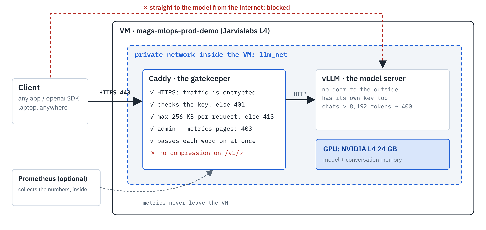

<div align="center">

# From model weights to production endpoints

**Serve an open LLM in production on one 24 GB GPU: no managed service, no vendor SDK.**
Docker + NVIDIA Container Toolkit + vLLM + Caddy, with every command reproducible from this repo.

[](https://github.com/vllm-project/vllm)
[](https://caddyserver.com)
[](https://huggingface.co/Qwen/Qwen2.5-7B-Instruct)
[](docs/benchmarks.md)
[](docker-compose.yml)
[](LICENSE)

[Quickstart](#quickstart) · [Labs](#labs) · [Benchmarks](docs/benchmarks.md) · [Slides](docs/slides/) · [Run sheet](docs/demo-day.md) · [Troubleshooting](#troubleshooting)

</div>

---

This repo accompanies a 3-hour hands-on workshop for engineering faculty and PG researchers at the **ISTE STTP, K. J. Somaiya School of Engineering, Mumbai** (Thu 3 Dec 2026). It takes Qwen2.5-7B-Instruct from Hugging Face weights to an authenticated, streaming, observable endpoint, then pushes it: quantization under load, prefix caching, multi-tenant LoRA, a bad release rolled back with zero failed requests, and a graceful drain.

Everything runs on **any Ubuntu machine with an NVIDIA GPU ≥ 24 GB**. The instructor uses a rented Jarvislabs L4 VM, but no cloud account, GitHub secret or Actions workflow is needed to follow along.

## Highlights

- **One GPU, real production shape.** vLLM is never exposed; Caddy is the only door: bearer auth, 401/403/413, a 256 KB body cap, and SSE streaming that flushes every token.
- **Four serving profiles, one command each.** BF16, AWQ (Marlin), online FP8, and BF16 + two LoRA tenants. `scripts/up.sh <profile>` switches, waits for `/health`, then *proves* the running container is the profile you asked for.
- **Measured, not guessed.** Every number on the slides comes from an L4 run, with the CSV in [`results/`](results/) ([benchmarks](docs/benchmarks.md)).
- **Pinned end to end.** Images by `@sha256` digest, model and adapter weights by commit, the `jl` CLI by version.
- **Safe rollouts.** Repoint the `sql-prod` LoRA alias in place under live traffic: 1,199 requests, **0 non-2xx**.
- **A fallback that works.** A GitHub Actions workflow moves the same disk to a bigger GPU (L4 → H200 verified in under 10 min) and can emulate the L4's memory budget.

## What you will see

| | BF16 | AWQ |
|---|---|---|
| Weights in VRAM | 14.29 GiB | 5.29 GiB |
| KV-cache tokens (≈ concurrent 8k chats) | 70,656–78,848 (≈ 9) | 237,568 (29) |
| Throughput, 32 concurrent streams | 484 tok/s | 1,295 tok/s |
| Pressure test: 32 × 3k-token prompts | KV 100%, **6 preemptions**, 180 s | KV 52%, **0 preemptions**, 82 s |

Prefix cache on an ~8k-token chat history: time to first token **2,247 ms → 133 ms**. Caddy adds **0 ms** to time to first token. Full tables: [`docs/benchmarks.md`](docs/benchmarks.md).

## Architecture

<p align="center"></p>

```
client ──HTTP──► Caddy :80  (bearer auth · 401/403/413 · SSE flush)  ──internal network──► vLLM :8000 (never published)
operator ─SSH tunnel─► Caddy 127.0.0.1:9090  (/metrics, LoRA load/unload)  ──────────────►
```

The lab serves plain HTTP on port 80 of the VM (the diagram shows the HTTPS target). Metrics and the LoRA admin API are reachable only through the loopback operator listener, over an SSH tunnel.

## Quickstart

**Requirements**

- Ubuntu 22.04/24.04, NVIDIA driver **R580+** (the vLLM image is CUDA 13; on R535/R570 set `VLLM_ENABLE_CUDA_COMPATIBILITY=1` in `.env`).
- GPU with ≥ 24 GB VRAM and compute capability ≥ 8.0 (fp8 KV cache needs ≥ 8.9).
- ~80 GB free disk: vLLM image 36 GB unpacked, BF16 + AWQ weights ≈ 21 GB, adapters 0.4 GB.
- `scripts/setup_host.sh` installs Docker, the NVIDIA Container Toolkit and [`uv`](https://docs.astral.sh/uv/) if they are missing.

**On the GPU host**

```bash
git clone https://github.com/MagmaCubes1133/mags-mlops-prod-demo && cd mags-mlops-prod-demo
bash scripts/setup_host.sh                      # log out and back in once if it added you to the docker group
cp .env.example .env && sed -i "s/^GATEWAY_KEY=.*/GATEWAY_KEY=$(openssl rand -hex 24)/" .env
bash scripts/prefetch_artifacts.sh all          # images (by digest), pinned weights, adapters, sql-v2 (≈ 5 min)
bash scripts/up.sh baseline                     # waits for /health, then verifies the running profile
bash scripts/smoke_test.sh                      # auth, limits, streaming: all PASS
```

**Your first request**

```bash
export GATEWAY_KEY=$(sed -n 's/^GATEWAY_KEY=//p' .env)
curl -s localhost/v1/chat/completions -H "Authorization: Bearer $GATEWAY_KEY" -H 'Content-Type: application/json' \
  -d '{"model":"qwen2.5-7b","temperature":0,"messages":[{"role":"user","content":"Hello"}]}'
```

The endpoint is OpenAI-compatible, so the `openai` SDK works with `base_url="http://<host>/v1"`. Python scripts run with `uv run`; their dependencies are declared inline.

<details>
<summary><b>Other GPUs</b></summary>

Copy the closest `profiles/<GPU>.env` values (`MAX_MODEL_LEN`, `GPU_MEMORY_UTILIZATION`) into `.env`. Ampere GPUs (sm_80/86) cannot use the fp8 KV cache. Profiles ship for L4, H100, H200 and RTX PRO 6000.
</details>

<details>
<summary><b>Renting a Jarvislabs VM (what the instructor uses)</b></summary>

```bash
uv tool install jarvislabs==0.2.17 && export JL_API_KEY=...        # https://jarvislabs.ai
ssh-keygen -t ed25519 -f ~/.ssh/mags_jl -N "" && jl ssh-key add ~/.ssh/mags_jl.pub --name mags-mlops-prod-demo
jl create --gpu L4 --vm --storage 200 --name mags-mlops-prod-demo --yes   # a VM, not a template: templates can't run Docker
jl ssh <machine_id>
```

- Pause when idle: `jl pause <id> --yes`. The disk is kept, and it is billed while paused.
- `jl resume <id> --gpu H200` moves the same disk to a bigger GPU in the same region. Every resume gives a new machine id.
- An L4 VM cost ₹41.31/h (≈ $0.49/h) in Nov 2026.
</details>

## Labs

Every **VM-side** step has one entrypoint: `bash scripts/lab.sh <lab> <step> [arg]`. **Laptop-side** steps run against Caddy with `BASE_URL=http://<host>` and `GATEWAY_KEY` set. For metrics from a laptop, keep an SSH tunnel to port 9090 open (`scripts/tunnel.sh` for the Jarvislabs VM, otherwise `ssh -N -L 9090:127.0.0.1:9090 <you>@<host>`).

| Lab | On the GPU host (`lab.sh`) | On the laptop | You should see |
|---|---|---|---|
| **1 · First boot** | `lab1 up` · `lab1 bootlog` · `lab1 nvidia-smi` | `python3 scripts/vram_math.py` | weights 14.29 GiB; ~9 concurrent 8k chats; maths matches the boot log |
| **2 · Gateway** | `lab2 edge-up` · `lab2 caddy-validate` · `lab2 caddy-reload` · `lab2 show-config` | `bash scripts/smoke_test.sh`; `curl -N` a stream; `uv run scripts/demo_structured_output.py` | 401/403/413/400 PASS; zero-downtime reload; `guided_json` silently ignored |
| **3 · Observability** | `lab3 metrics kv_cache` · `lab3 prefix-cache` | `uv run scripts/demo_prefix_cache.py` (add `--repeat 130` for an ~8k history) | warm TTFT 5–17× faster; ~82% hit rate |
| **4 · Quantization under load** | `lab4 switch baseline\|awq\|fp8\|fp8-kv` · `lab4 vram-math` · `lab4 metrics-watch start\|stop` | `uv run scripts/benchmark_concurrency.py --label awq` (sweep) · `--preset pressure` | BF16 preempts and queues; AWQ doesn't |
| **5 · Multi-LoRA rollout** | `lab5 lora-up` · `lab5 make-v2 64` · `lab5 lora-swap v2` / `v1` · `lab5 lora-status` | `uv run scripts/demo_multilora_rollout.py rollout --swap-mode none --duration 120` | a bad adapter ships and is rolled back; `TOTAL non-2xx: 0` |
| **6 · Graceful drain** | `lab6 drain`, then `common restart` | a long `curl -N` stream | vLLM stops in ≈ 26 s; the stream still finishes |

Always available: `common status` (prints the active profile) · `common logs vllm 100` · `common restart` · `common down` · `common capture`.

### Endpoint and API key

- **API key.** Caddy accepts exactly one bearer token: `GATEWAY_KEY` from the host's `.env`. You choose it. The Quickstart generates a random one; any value made of `A–Z a–z 0–9 _ -` works (use ≥ 32 characters). Change it in `.env`, then `bash scripts/up.sh <profile>` to restart Caddy with it.
- **Endpoint.** `http://<host-ip>` on port 80; the API lives under `/v1`. On the GPU host itself, use `http://localhost`.

### Running the client scripts from your laptop

Every laptop-side script reads `BASE_URL` (default `http://localhost`) and `GATEWAY_KEY` from the environment.

```bash
# in your local clone; .env holds the same GATEWAY_KEY as the GPU host
set -a; . ./.env; set +a                         # exports GATEWAY_KEY
export BASE_URL=http://<host-ip>                 # Jarvislabs VM: export BASE_URL=http://$(scripts/tunnel.sh ip)
ssh -N -L 9090:127.0.0.1:9090 <you>@<host-ip> &  # optional: metrics + LoRA admin (Jarvislabs: scripts/tunnel.sh)

bash scripts/smoke_test.sh                       # 401/403/413/400, /health, a stream, every model; metrics checks need the tunnel
uv run scripts/demo_prefix_cache.py
uv run scripts/benchmark_concurrency.py --label bf16
```

Without the tunnel, the scripts skip their metrics parts and say so.

<details>
<summary><b>LoRA request example</b></summary>

```bash
# lora profile; the prompt format the sql adapter was trained on
curl -s localhost/v1/completions -H "Authorization: Bearer $GATEWAY_KEY" -H 'Content-Type: application/json' \
  -d '{"model":"sql-prod","temperature":0,"max_tokens":64,
       "prompt":"Convert the following natural language question to SQL:\n\nDatabase: employees(id, name, dept, salary)\nQuestion: Average salary per dept?\n\nSQL:"}'
```

Compare adapters side by side (needs the tunnel): `uv run scripts/demo_multilora_rollout.py compare /adapters/sql-v1 /adapters/sql-v2`.
</details>

<details>
<summary><b>Windows (Git Bash) laptops</b></summary>

Run `export MSYS_NO_PATHCONV=1 PYTHONUTF8=1` first. Without it, Git Bash rewrites `/adapters/...` arguments into Windows paths and LoRA loads return 404.
</details>

## vLLM v0.34.0: what differs from most blog posts

- The KV metric is `vllm:kv_cache_usage_perc`, not `gpu_cache_usage_perc`.
- Online FP8 is `--quantization fp8_per_tensor`. Plain `fp8` still works but logs a deprecation warning and runs the same scheme. For AWQ, just serve the AWQ checkpoint: Marlin kernels are picked automatically.
- `--gpu-memory-utilization` defaults to **1.0** (extensible KV cache); this repo sets 0.90. `--kv-cache-memory-bytes=4G` pins the KV pool.
- `guided_json` is removed and **silently ignored**. Use `structured_outputs` or `response_format: json_schema`.
- `--api-key` guards only `/v1/*`. `/metrics`, `/health` and `/load` stay open, so the gateway blocks them.
- In `VLLM_EXTRA_ARGS`, always write `--flag=value`: `.env` is also sourced by bash.

## Repository layout

```
├── docker-compose.yml        vllm-{baseline,awq,fp8,lora} (one at a time) + caddy; internal network, healthchecks, drain
├── Caddyfile                 public site (auth, 403 internal paths, body cap, SSE) + loopback operator listener :9090
├── profiles/<GPU>.env        per-GPU knobs: L4, H100, H200, RTX-PRO6000
├── scripts/
│   ├── lab.sh                the single on-host entrypoint for every lab step
│   ├── up.sh                 switch profile → wait for /health → verify the running container
│   ├── setup_host.sh, prefetch_artifacts.sh, smoke_test.sh
│   ├── benchmark_concurrency.py, demo_prefix_cache.py, demo_multilora_rollout.py, demo_structured_output.py
│   ├── vram_math.py, make_regressed_adapter.py
│   └── remote.sh, tunnel.sh  laptop helpers: run a step via GitHub Actions; SSH tunnel for metrics
├── .github/workflows/        demo-gpu.yml (provision / deploy / swap GPU / pause) · lab.yml (one lab step over SSH)
├── results/                  benchmark CSVs measured on the L4
└── docs/
    ├── benchmarks.md         every measured number, with method
    ├── demo-day.md           presenter run sheet: timings, expected output, fallbacks, likely questions
    ├── lab-actions.md        every lab step with its measured latency
    └── slides/               the deck (.pptx) and its 15 diagrams
```

## Workshop materials

- **Slides:** [`docs/slides/`](docs/slides/): 55 slides with a diagram-to-slide map.
- **Presenters:** [`docs/demo-day.md`](docs/demo-day.md): T-24 h and T-60 min checks, per-segment commands and expected numbers, GPU fallback, likely audience questions.

<details>
<summary><b>Instructor: GitHub Actions fallback</b></summary>

`Actions → demo-gpu → Run workflow`. Secrets: `JL_API_KEY`, `JL_SSH_PRIVATE_KEY`, `GATEWAY_KEY`, optional `HF_TOKEN`.

- **L4 unavailable?** Re-run with `gpu=auto` (walks `L4,H100,H200,RTX-PRO6000`, VM offerings only) or `action=swap-gpu gpu=H200` (same disk, same region). A100/A30 are container-only on Jarvislabs (no Docker), so they are not in the chain.
- **Balance rule:** Jarvislabs starts an instance only if the `jl status` balance covers 1 h of its list price (H200: ₹434.97). A running VM is not reserved.
- `emulate_l4=true` pins the KV pool to the L4 size, so KV-capacity demos match the slides. Latency is still faster: say so.
- **Lab steps without SSH:** `scripts/remote.sh <lab> <step> [arg]` dispatches `lab.yml` and streams the output (35–130 s per step). A failed VM sync fails the run.
- Logs are public: the workflows mask every id and IP.
- **The API key comes from the `GATEWAY_KEY` repo secret.** Every `provision`, `deploy`, `resume` and `swap-gpu` run writes it into the VM's `.env`. To change it, update the secret *and* your local `.env` to the same value, then run `action=deploy` (or the next `resume`).
- **The endpoint is never in the logs.** Get it on your laptop with `scripts/tunnel.sh ip` (uses your Jarvislabs key). It changes on every resume.

**What runs entirely on Actions:** provisioning, resume, pause, GPU swap, deploy, the smoke test (on the VM, in `verify`), and every VM-side lab step. **What needs a laptop:** the client-side scripts (load tests, prefix cache, LoRA rollout traffic, structured output, `curl` streams), since they are the demo of a client calling the endpoint.
</details>

## Troubleshooting

| Symptom | Fix |
|---|---|
| `could not select device driver "nvidia"` | `sudo nvidia-ctk runtime configure --runtime=docker && sudo systemctl restart docker` |
| `permission denied … docker.sock` | `bash scripts/setup_host.sh`, then log out and back in |
| vLLM exits with a CUDA driver error | driver < R580: set `VLLM_ENABLE_CUDA_COMPATIBILITY=1` in `.env` |
| CUDA OOM at boot | lower `MAX_MODEL_LEN` or `GPU_MEMORY_UTILIZATION`; run one profile at a time (`scripts/up.sh` does this) |
| `LocalEntryNotFoundError` / tries to download | run `scripts/prefetch_artifacts.sh <profile>`: vLLM runs offline on an internal network |
| Streaming arrives all at once | don't add `encode` to the public site; keep `flush_interval -1` |
| 401 with the right key | the header must be exactly `Authorization: Bearer <key>` |
| `WRONG PROFILE: …` from `up.sh` | another profile's container is still running, or `.env` overrides the command: `docker ps`, then `scripts/up.sh <profile>` again |
| LoRA load → 404 `No adapter found for C:/Program Files/Git/adapters/...` | Git Bash path conversion: `export MSYS_NO_PATHCONV=1` |
| 400 on a long chat | prompt + `max_tokens` exceeds `MAX_MODEL_LEN` (8,192) |
| Port 80 unreachable from outside | `ssh -L 8080:localhost:80 ubuntu@<vm>` and use `http://localhost:8080` |

## About the author

<table>
<tr>
<td width="170" valign="top"></td>
<td valign="top">

**Saumya Saraswat**: I build AI systems and run them in production.

- **Now:** Founding Engineer at a US-based fintech.
- **Previously:** AI/ML engineer at ION Analytics (ION Group), owning production systems end to end, from prototype through CI/CD to monitoring.
- **Education:** B.Tech CSE, LNMIIT.
- **Side projects:** AQI forecasting (ET Hackathon 2026); real-time game-playing models that react in under 30 ms from frame to action on a laptop.

GitHub: [@MagmaCubes1133](https://github.com/MagmaCubes1133)

</td>
</tr>
</table>

## Acknowledgements

Built on [vLLM](https://github.com/vllm-project/vllm), [Caddy](https://caddyserver.com), [Qwen2.5-7B-Instruct](https://huggingface.co/Qwen/Qwen2.5-7B-Instruct) and its [AWQ build](https://huggingface.co/Qwen/Qwen2.5-7B-Instruct-AWQ), and the LoRA adapters [vindows/qwen2.5-7b-text-to-sql](https://huggingface.co/vindows/qwen2.5-7b-text-to-sql) and [TIGER-Lab/StopLoss-Qwen2.5-7B-Instruct](https://huggingface.co/TIGER-Lab/StopLoss-Qwen2.5-7B-Instruct). Thanks to ISTE and K. J. Somaiya School of Engineering for hosting the STTP. GPU time on [Jarvislabs](https://jarvislabs.ai).

## License

[MIT](LICENSE) © 2026 Saumya Saraswat. Model weights and adapters keep their own licences on Hugging Face.
